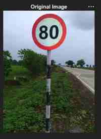
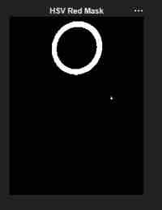
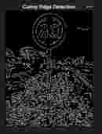
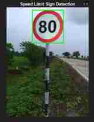

# MATLAB results

The screenshots below were supplied from the author's MATLAB run on the road photograph containing a speed-limit sign displaying **80**.

## Original road image

## RGB red mask

## HSV red mask

## Canny edge detection

## Final speed-limit sign detection

The final detection screenshot shows a green bounding box around the sign. The author's experiment notes report that RGB produced the clearer mask for this image and selected thresholds.

## Two additional screenshots requested by the assignment

The updated MATLAB script now displays the RGB channel figure and the cleaned RGB mask. Capture and add those two outputs after running the updated script. They were not part of the five supplied screenshots.

These are example-specific results, not a benchmark or accuracy evaluation.
